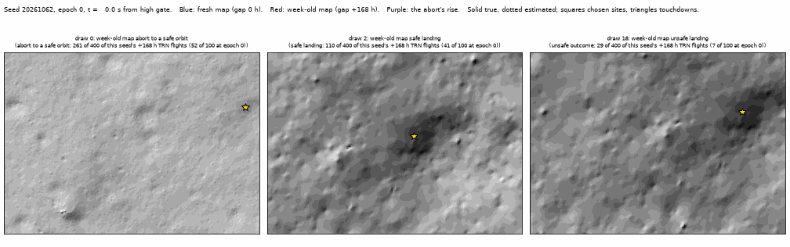
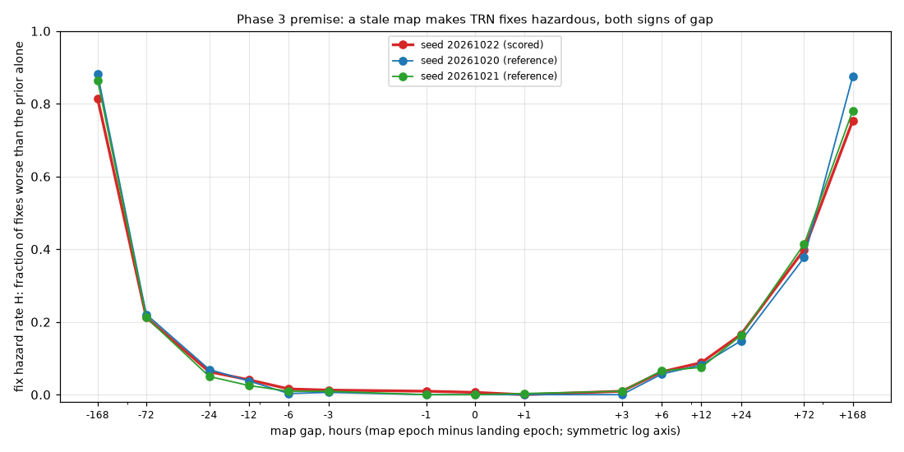
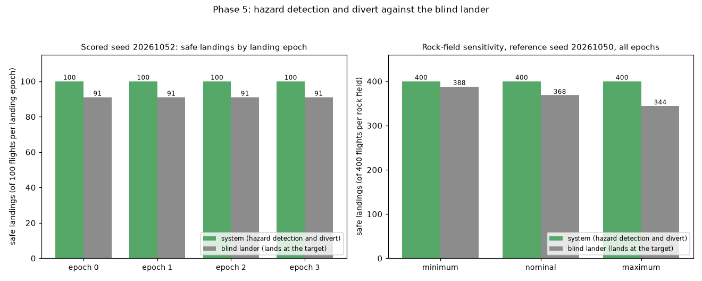
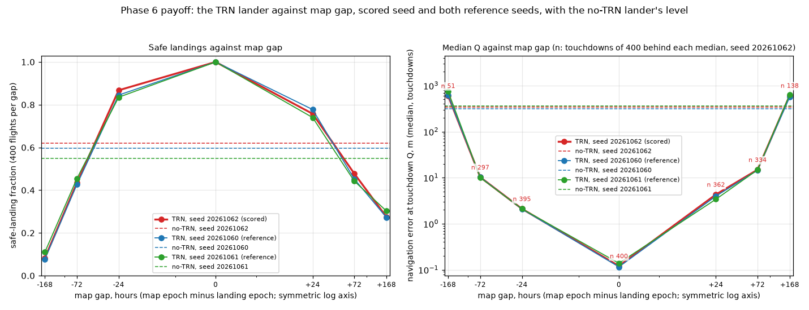
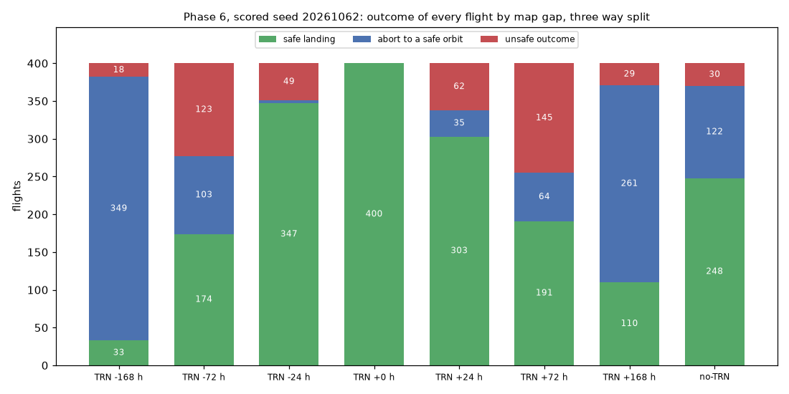
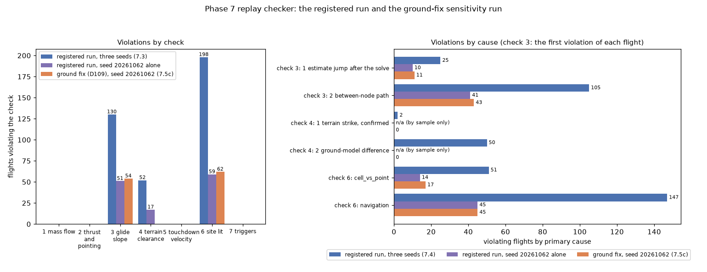
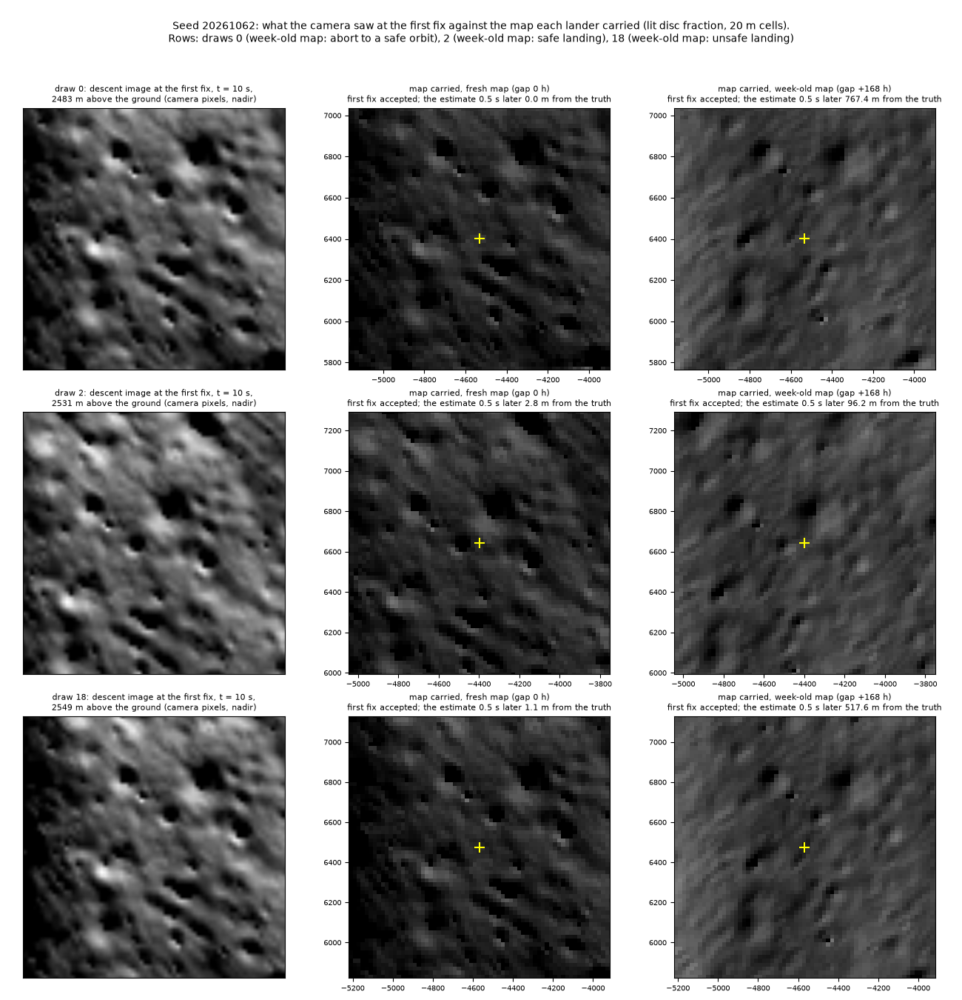
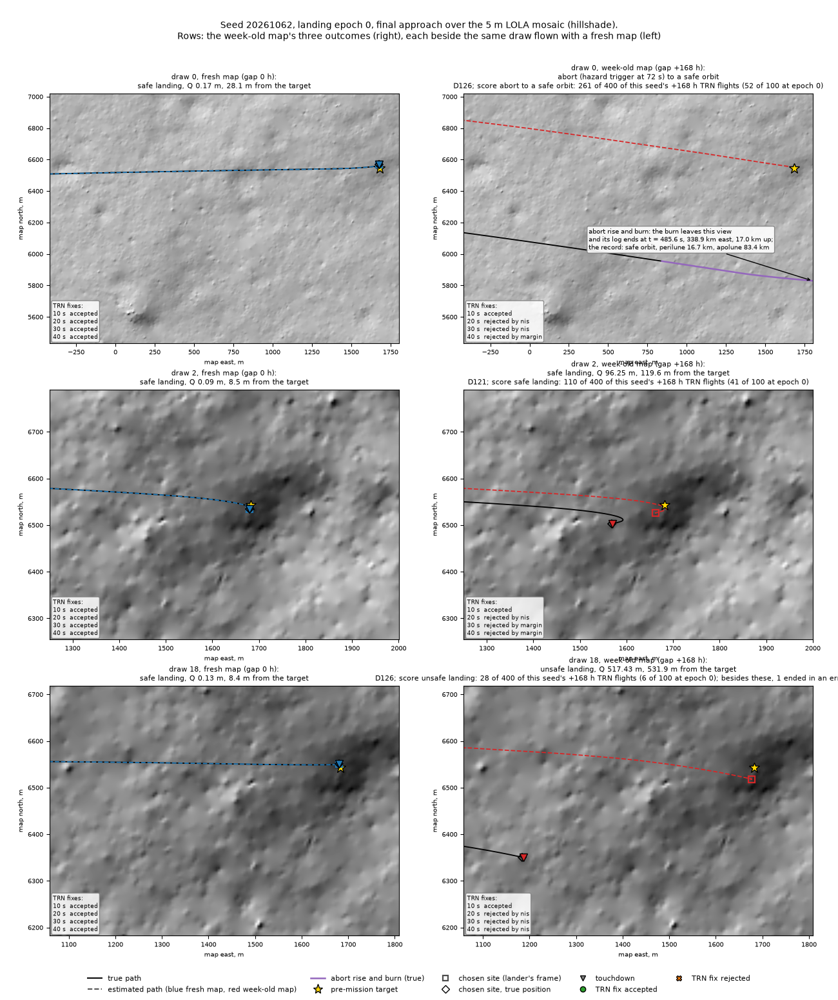

# lunar-landing-gnc

Guidance, navigation and control for a crewed class lunar lander descending to
the south pole, on the real LOLA terrain with a SPICE sun, built to test one
claim: at the south pole a terrain relative navigation reference map expires as
the low sun's shadows move, and that expiry carries through the navigation filter
to the touchdown. The claim held. The independent replay checker that judges
every flown trajectory failed its own registered bar, and every one of its
violations was traced to a cause.



*Scored seed 20261062, landing epoch 0, draws 0, 2 and 18, each flown with a
fresh reference map and with one a week old (+168 h). The draws were picked by
rules registered before any was looked at: the lowest numbered draw whose fresh
map flight lands safely and whose week-old flight aborts to a safe orbit (draw
0), lands safely (draw 2) or lands unsafely (draw 18). Most week-old flights
abort: 261 of this seed's 400 at +168 h.*

**In short.** With the same filter, guidance and hazard detection, a fresh
reference map landed all 400 flights of the scored seed safely, with a median
touchdown position error of 0.12 m. A map one day old lost 13 to 24 pct of the
landings and the error grew to 2 to 4 m; three days, about 55 pct lost and 10 to
15 m; a week, 72 to 92 pct lost and about 600 m, worse than a lander with no map
at all, which landed 62 pct. Both halves of the claim, the fix error at the
correlator and the outcome at the ground, were measured against bars registered
before the scored seed was flown, and both passed. Where the work failed its own
registered criteria it says so below, with the cause.

## What is here

A lunar module class lander flies the approach phase from high gate (2,134 m up,
152.4 m/s toward the site) to touchdown near a pre-mission target at the south
pole. Every part of the loop is in this repository:

* **A descent image renderer** that shades the LOLA 20 m DEM under a SPICE sun
  with a finite solar disc and per cell horizon profiles, checked against nine
  LRO NAC observations.
* **Convex powered descent guidance** (lossless convexification, solved with
  Clarabel), re-planned every 2 s in closed loop, with a glide-slope cone and a
  pointing limit, checked against a published worked example and against an
  indirect Pontryagin solution.
* **Abort logic** with four triggers (lost lock, hazard, propellant reserve,
  infeasible plan) and three abort branches (descent engine, ascent stage, and
  the two combined), flown to orbit and judged on where they end.
* **Navigation**: a filter fusing IMU, the Doppler lidar's range and velocity,
  and terrain relative navigation (TRN) fixes that correlate a descent image
  against an onboard reference map rendered for some epoch.
* **A C++17 port** of the flight code (filter, TRN fix, guidance, triggers,
  aborts, terminal descent) with Eigen and Clarabel.cpp, checked against the
  Python on recorded traces and in closed loop.
* **LiDAR hazard detection and site selection**: a flash lidar scan of a truth
  surface built from the LOLA 5 m mosaic and a sourced rock field, hazards judged
  by the Apollo landing gear's limits, and a divert to the chosen site.
* **A Monte Carlo over the map epoch gap**: each draw flown at every gap from
  -168 h to +168 h and at four landing epochs, with only the reference map
  changing, beside a lander with no TRN at all.
* **A replay checker**, a separate program sharing no code with the flight, run
  over every logged trajectory on seven checks.

The claim in one sentence: at the south pole a terrain relative navigation
reference map expires as low-sun shadows move, and that expiry carries through
the filter to the touchdown.

Carried from the earlier lunar-polar-traverse project and used as they are: the
explicit MOON_ME_DE421 frame, the Snyder south polar stereographic projection,
and the horizon lit test (sun elevation above the horizon elevation at the sun's
azimuth). The sun itself is computed here by `sun.py`, and no sun vector, lit
table or interval table from that project is reused.

## Results

Each phase registered its bar in a private working record before the run it
judges, then reported the result as it fell. Nothing below was rescored. The
seeds named as scored were never used before their scored run.

### The renderer (phase 1)

* **Sun geometry: PASS.** The computed sun elevation at nine NAC observations against
  90 deg minus LROC's incidence: median residual +0.00113 deg, all nine within
  tolerance.
* **Point source shadow mask: FAIL** on one criterion (alignment on both frames
  of M184288222). Diagnosed: shadows cast by occluders a median 10.1 km away
  were displaced along the sun direction.
* **Finite solar disc mask: FAIL** on criterion 4, a 2 cell alignment bar: the
  best shift on M184288222 LE was 2.24 cells. The offset fell from (-7, -6) and
  (-11, -5) cells to under 2.3, so the mechanism held; the bar was set without
  measuring the published simulation's own alignment on that frame, which is
  2.83 cells. A registration error, recorded.
* **Photometry: PASS**, all three criteria, with the continuous disc renderer
  that every later phase uses.

### Guidance and aborts (phase 2)

* **Against Acikmese and Ploen (2007): FAIL** on case 3 only. Cases 1 and 2
  match the published fuel to +0.098 and +0.116 pct at the published final
  times. Case 3 found an optimum 3 s earlier and 1.105 kg lighter than the
  published one, on a fuel curve about six times flatter than the other two, and
  its largest lossless gap was 1.3e-6 against a 1e-6 threshold that was solver
  tolerance (tightening the solver took it to 3.6e-9). The lesson recorded: a
  final time criterion means little where fuel is flat in final time.
* **Against an indirect Pontryagin solution: FAIL** on the throttle pattern
  test. Final mass agrees to -0.0064 pct, switch times to 0.05 s and thrust
  direction to 0.128 deg; but the convex final burn sits at throttle 0.7982,
  outside a 1e-3 band set without deriving it. The cause is measured: the
  convex formulation's linear thrust bound is conservative, so its last burn
  under-uses the thrust by about 0.2 pct.
* **Closed loop guidance: PASS**, 6 of 6 on a fresh seed: 200 of 200 landed,
  horizontal touchdown error p95 0.784 m (bar 1.046 m), touchdown velocity error
  p95 0.0490 m/s (bar 0.052), closed loop better than open loop in 200 of 200
  pairs.
* **Aborts: PASS**, 7 of 7 on fresh seeds: 0 false alarms in 200 nominal
  flights, 0 missed and 0 false aborts, and the combined abort reached orbit
  from 150 of 150 faulted flights (bar 147), where the ascent stage alone reached
  the ground from every thrust fault.

### The premise (phase 3)



The premise is measured at the correlator, before any filter. H(g) is the
fraction of TRN fixes at map gap g whose error is larger than the prior's alone,
a fix worse than taking none. **PASS, 4 of 4**, on scored seed 20261022:

| Criterion | Bar | Scored |
| --- | --- | --- |
| Fresh map: H(0) | at most 0.01 | 0.0063 (2 of 318) |
| Fresh map: median fix error | at most 10 m | 4.08 m |
| One day wrong: paired sign test, -24 h and +24 h | p below 0.01 | 3.8e-6 and 1.7e-13 |
| Rising with gap, each sign | H(24) < H(72) < H(168) | 0.063, 0.213, 0.814 before; 0.166, 0.398, 0.753 after |
| A week wrong: H(-168 h), H(+168 h) | at least 0.5 | 0.814, 0.753 |

The median fix error stays near 4 m to 6 h of gap, then reaches 10 to 28 m at
72 h and 0.9 to 1.0 km at 168 h. At half a lunation the map is 6.8 pct lit and
no fix is possible.

The filter's own consistency step was **not reached**: on both reference seeds
its NEES fell inside the bound at 6 and 5 of 10 times where 7 were needed, every
miss on the low side, so the filter is underconfident by about 10 pct. By the
bar's rule its scored seed was never run, and that filter was carried into
phase 6 as it stood.

### The C++ flight code (phase 4)

Clarabel.cpp at 0de6259 (Clarabel.rs v0.11.1), built with cargo `--release
--locked --offline` against a recorded Cargo.lock, C++17, `-O2 -DNDEBUG
-ffp-contract=off`. Before scoring, every part was replayed against the Python
on recorded traces, mostly bit for bit and otherwise to rounding.

On scored seed 20261041:

* **Item 2, agreement of each compared quantity: FAIL, 7 of 251 over their
  bars.**
  Every one of the seven is at or inside the scored seed's own one ulp spread,
  the amount the Python moves when its own inputs move by one ulp. The bar rule,
  10 times the largest difference on the reference seed, ignored that spread:
  where the reference C++ happened to agree bit for bit, the bar became zero. A
  bar derived from the quantity's own error would have passed them. The port
  shows no defect.
* **Item 3, discrete agreement: PASS.** Every discrete decision agrees outside
  recorded ties.
* **Item 4, timing: PASS** on the filter tick (0.216 ms, bar 5 ms), the TRN fix
  (372 ms, bar 10 s) and the window re-solve (77.6 ms, bar 2 s); **FAIL** on the
  widened final time re-solve (18.2 s, bar 2 s), as predicted before the port.
  That is a design finding: the widened search that decides the infeasible abort
  cannot run inside one re-plan period, because the solver's native time alone
  exceeds it. The C++ aborts plan in 28 ms median against the Python's 1.16 s.

### Hazard detection (phase 5)



Flown on the true state, so this is the hazard system alone. **PASS on all four
criteria** at every landing epoch of scored seed 20261052: 0 of 100 unsafe
landings (bar 2), never worse than the blind lander that lands at the target,
0 unsafe chosen sites, and a median detection agreement of 0.9876 (bar 0.97).
Across both reference seeds and the scored seed the system landed safely on all
1,200 flights; the blind lander on 1,120. On one reference seed the system stayed
safe on every flight from 290 to 8,622 rocks in the 150 m square, while the blind
lander fell from 97 to 86 pct.

### The payoff (phase 6)



Q is the touchdown navigation error: the distance between where the lander
believes it touched down and where it did. The whole loop flies on the filter's
estimate: guidance, the triggers, the scan, site selection, the divert and the
terminal descent. Each draw is flown at every gap and landing epoch with the same
dispersions, rocks, sensor noise and scan bias; only the reference map changes.
The no-TRN lander is the same draw with no fix at all.

The bar was registered on 7 Nov 2026, from two reference seeds, before any
flight of the scored seed 20261062. **PASS, all 19 sub-conditions:**

| Criterion | Bar | Scored |
| --- | --- | --- |
| A fresh map lands: gap 0 flights not ending in a safe landing | at most 2 of 400 | 0 |
| A fresh map lands: Hp(0) | at most 0.01 | 0 |
| A fresh map lands: median Q at gap 0 | at most 1.0 m | 0.121 m |
| One day wrong costs landings: sign test over draws, -24 h and +24 h | p below 0.01 | 4.4e-16 and 8.5e-22 |
| One day wrong shows at touchdown: median Q, -24 h and +24 h | at least 1.0 m | 2.11 and 4.31 m |
| The cost rises: safe fraction falls from 24 to 72 to 168 h, each sign | strictly | 0.868, 0.435, 0.083 before; 0.758, 0.478, 0.275 after |
| The cost rises: median Q rises over the same gaps | strictly | 2.11, 10.2, 602 m before; 4.31, 14.9, 608 m after |
| A week wrong is worse than none: Hp, -168 h and +168 h | at least 0.5 | 0.697 and 0.711 |
| A week wrong is worse than none: safe fraction below the no-TRN lander's 0.620 | by at least 0.10 | by 0.537 and 0.345 |

Hp(g) is the fraction of draws, among those where both landers touched down,
whose Q at gap g is worse than the no-TRN lander's Q on the same draw. The
number beside each point in the right panel is the touchdowns behind that
median: at large gaps the median describes a small and selected subset, 138 of
400 flights at +168 h.



The filter's gates turn most of the loss at old maps into aborts to a safe orbit
rather than unsafe landings: at +168 h, 110 safe landings, 261 aborts to a safe
orbit and 29 unsafe outcomes of 400. Over the whole scored seed, 445 landings
were unsafe: 374 off the verified site (the lander touched down more than the
2.09 m landing radius from the true position of the site it had chosen and
scanned), 47
on a site the hazard map wrongly called safe, and 24 drifts beyond the margin;
70 of the 445 touched ground the gear could not take. No flight on this seed
struck the terrain.

### The replay checker (phase 7)



All 8,700 jobs of the three phase 6 seeds were flown again with logging, and the
re-fly reproduced phase 6 field for field on 2,900 of 2,900 jobs per seed. The
checker imports nothing from the flight code: it restates the vehicle from the
published sources, reads the terrain from the GeoTIFFs with its own code, and
judges every logged trajectory on seven checks, each with a tolerance derived
from its own error and registered before any registered seed was re-flown.

**FAIL.** 380 of 9,579 flights judged violate a check beyond its tolerance: glide
slope 130, terrain clearance 52, site lit 198. Mass flow, thrust and pointing,
touchdown velocity and every abort trigger held on every flight. Every one of the
380 was then diagnosed, read only, and in none is the checker wrong. Three
findings:

1. **The lander lands in shadow in 2 pct of flights** (check 6, 198). In 147 the
   lander tested the sun at its chosen site's 20 m cell in its own estimated
   frame and touched down elsewhere, a median 60.6 m away, in shadow: a
   consequence of the expired map. In 51 it touched down inside the tested cell
   but in shadow, which a test of one cell centre cannot see. The lit test is a
   design limit of the lander.
2. **The glide slope is broken between guidance nodes** (check 3, 130). Guidance
   meets the cone at every 2 s node, but its path between the measured state and
   the first node can dip below it, by up to 4.26 deg, close to the site. The
   convexified guidance constrains the cone only at its nodes.
3. **The simulation's truth ground sat half a 5 m cell off the LOLA mosaic**
   (check 4). The window read for the truth surface kept a half pixel origin in
   its transform while reading whole pixels, so the ground the flights touched
   was the mosaic shifted 2.5 m west and 2.5 m north. That explains 80 of the
   clearance samples; the other 59 are 2 real terrain strikes. Every comparison
   in phases 5 to 7 was made inside that one consistent, shifted world, so the
   registered results stand as they fell.

**The ground-fix sensitivity.** The fix went in as an option, `ground_fix`, off
by default so the public code still reproduces every registered result. The
scored seed was flown again once with it on, as a stated sensitivity, never as a
replacement, with three predictions registered before the flight. All three
held: the payoff criteria still pass, 19 of 19, with nearly the same values (safe
fraction -24, -72, -168 h 0.868, 0.423, 0.093 against 0.868, 0.435, 0.083
registered; +24, +72, +168 h 0.760, 0.468, 0.295 against 0.758, 0.478, 0.275);
check 4's ground model violations go from 17 flights to 0; and checks 3 and 6
keep their causes, at 54 and 62 flights against 51 and 59. The claim does not
rest on the fault.

### The map against the camera, and the plan view



The descent image the camera saw at the first fix, beside the reference map each
lander carried: the fresh map's shadows match the image, the week-old map's are
a week later. Draw 2's week-old first fix was accepted against the stale map but
was a wrong match, moving the estimate from 686 m off to 96 m off; its next three
fixes were rejected, and it landed safely 95.8 m from where it believed its site
was.



The final approach of each flight: the true and estimated paths, the TRN fixes
and their outcomes, the chosen site in the lander's frame and its true position,
and the touchdown. The captions of every view, and what each does not show, are
in [docs/traj_viz.md](docs/traj_viz.md); the result figures' captions and sources
are in [docs/fig_captions.md](docs/fig_captions.md).

## Limitations

* **The fresh map figures are optimistic.** The descent image at gap 0 is
  rendered from the reference map itself, so a fresh map matches it by
  construction.
* **The filter is underconfident by about 10 pct** in NEES on fresh maps, and its
  consistency step was not reached.
* **Unsafe landings off the verified site cannot be split** into estimate drift
  and scan placement: the records do not hold what would separate them.
* **The lit test reads one 20 m cell centre in the estimated frame**, so a lost
  lander can land in shadow, and shadow inside the cell is missed (phase 7).
* **The glide-slope cone is enforced only at guidance nodes** (phase 7).
* **The truth ground of phases 5 to 7 sits half a 5 m cell off the LOLA mosaic.**
  The fix is in the code but off by default; the registered results are on the
  shifted ground, and the sensitivity on one seed is the evidence the claim does
  not depend on it.
* **The 5 m surface is about 90 pct interpolated.** Only 9.9 pct of its pixels
  hold LOLA returns, so flatness at 5 m is partly the interpolation's
  smoothness.
* **Rocks come from a 1969 lander design model** (NASA SP-8023's nominal curve,
  height half the diameter), are cut at tile edges, and are not in the replay
  checker's ground.
* **The scan's processing time is taken as zero**, and the hazard abort branch
  never fired on realistic terrain; it is tested by a synthetic check only.
* **Mass is known to guidance, attitude is known exactly** (the simulation is
  three degree of freedom), and the navigation sensors have no range limits.
* **The safe orbit floor is Apollo's**, referred to the mean lunar radius. Some
  aborts passed within 5.7 m of the true ground; none touched it.
* **The widened final time search cannot run in one re-plan period** on a flight
  computer (phase 4).
* **Flights within a draw share its dispersions**, so counts pooled over landing
  epochs are dependent; every sign test is over draws for that reason. 8 to 10
  flights per seed ended in the scan planner's error (slant range under 150 m)
  and count as not safe.
* **The prior is a reading.** The 333 m prior sigma reads a published 1.0 km
  orbit determination uncertainty as 3 sigma; the source does not say whether it
  is 1 or 3 sigma.
* **The descent camera is not externally checked**: no real image with known view
  geometry was available, so it is checked against an analytic projection only.
* **The site lit check shares lineage with lunar-polar-traverse**: it uses that
  project's C++ horizon march and the same carried conventions, so it is
  independent of this project's code but not of those conventions.
* **Median Q at large gaps** describes only the flights that touched down, a
  shrinking and selected subset; aborts are not in it.

## Future work

Named in the record as it stands:

* An inter-sample glide-slope constraint: a tightened cone, or a finer constraint
  grid near the site.
* A lit test with a margin around the site at the lidar's resolution, or an
  onboard shadow check from the scan.
* The ground fix as the default in a future release, with the registered results
  kept reproducible.

## Requirements

Developed and measured on Ubuntu 24.04 with Python 3.12.3.

Python, in a virtual environment, pinned in `requirements.txt`:

```
numpy 2.5.2        scipy 1.18.1       matplotlib 3.11.2
rasterio 1.5.1     spiceypy 8.2.0     cvxpy 1.9.3
clarabel 0.11.1    pytest 9.1.1
```

`clarabel` is not imported directly; cvxpy calls it as the guidance solver.
`requirements.txt` also pins pybind11 2.13.6, which only the C++ build uses.

C++: GCC 13.3, CMake 3.28, Eigen 3.4, GoogleTest 1.14, and a Rust toolchain for
Clarabel.rs (cargo 1.99.1 here). The replay checker's site lit check calls the
built horizon binary of lunar-polar-traverse, found beside this repository or
through `LLG_E_ROOT`. The animation is encoded with ffmpeg (6.1 here).

Memory: the 20 m DEM is 2.7 GB and the 5 m mosaic 3.3 GB, and nothing here opens
either whole. A Monte Carlo worker peaks at about 2 GB; the runs here were
sized for an 8 GB cap.

## Data

`data/` holds only `data/reference/lroc_nac_observations.csv`, the epochs and
incidence angles read from each NAC observation's LROC product page. Everything
else is fetched into the directory named by `LLG_DATA`:

```bash
export LLG_DATA=/path/to/data
examples/fetch_data.sh
```

The script is resumable and downloads about 7.1 GB:

* the LOLA 20 m and 80 m south polar DEMs, PGDA product 90, 2.9 GB;
* the LOLA 87S to 90S mosaic at 5 m, `ldem_87s_5mpp.tif` (3.3 GB), and its return
  count map, `ldec_87s_5mpp.tif` (140 MB), PGDA product 81, from
  <https://pgda.gsfc.nasa.gov/data/LOLA_5mpp/87S/>, sizes as the product page
  lists them;
* nine LRO NAC observations map projected onto the 20 m DEM, with their published
  simulated counterparts, 27 files, 626 MB;
* the SPICE kernels (DE421, the lunar PA binary PCK, leapseconds, planetary
  constants, the Moon frames kernel), 19 MB.

The 5 m mosaic's product page states its convention: coordinates are pixel
registered, with X and Y at pixel centres. The half-cell ground fault found in
phase 7 is a window read that placed the data half a pixel off that grid.

## Setup

```bash
python3 -m venv .venv
.venv/bin/pip install -r requirements.txt
git submodule update --init --recursive
```

The flight code builds with:

```bash
examples/build_flight.sh
```

It builds Clarabel.rs with cargo `--release --locked --offline` against the
Cargo.lock in `src/extern/Clarabel.cpp/rust_wrapper`, whose sha256 the CMake file
checks, then the `llg_flight` library, the pybind11 module
`lunar_landing_gnc._flight`, the GoogleTest tests (which it runs) and the timing
bench, into `work/build/flight`. Clarabel.cpp's own cargo target is not used,
because it installs a tool from the network and builds unlocked. Being offline,
the build needs the 48 crates that Cargo.lock names already in the local cargo
cache; on a machine without them, `cargo fetch --locked` in that folder fetches
exactly those. The horizon ray march in `src/cpp` is built on first use by
`horizon.py`.

## Running it

```bash
# phase 3 premise: the 68 maps, the scored sweep and its score
.venv/bin/python examples/premise_scored.py maps
.venv/bin/python examples/premise_scored.py sweep
.venv/bin/python examples/premise_scored.py score

# phase 5 hazard detection, scored seed
.venv/bin/python examples/score_5_3.py fly
.venv/bin/python examples/score_5_3.py score FOLDER

# phase 6: one seed's flights (every gap and epoch, plus the no-TRN job, per draw)
.venv/bin/python examples/phase6_run.py --seed 2 --draws 1 --out work/dev
.venv/bin/python examples/score_6_3.py 20261062

# phase 7: re-fly with logging, then the replay checker
.venv/bin/python examples/phase7_log_run.py --seed 2 --draws 1 --out work/dev_log
.venv/bin/python examples/replay_check.py FOLDER --out OUT.json
.venv/bin/python examples/phase7_replay_run.py --src work/step7_2 --out work/step7_3

# figures
.venv/bin/python examples/make_traj_viz.py
.venv/bin/python examples/make_result_figures.py
```

The registered seeds are refused by `phase6_run.py` unless `--registered` is
given. A full seed is 100 draws, 2,900 flights. Re-flying all three seeds with
logging was estimated at about 30 h on 4 workers of a 16 thread desktop, and one
seed at about 10 h. The figure scripts read the committed results under `work/`
and run in seconds.

## Tests

```bash
.venv/bin/python -m pytest tests/ -q
work/build/flight/llg_flight_tests
```

688 Python tests and 117 GoogleTest tests. Every test names the bug or invariant
it protects rather than the function it calls. Every test was mutation checked
before it was believed: the code it guards is broken on purpose and the test
must fail. The harness runs `python -B` with the caches cleared, so stale
bytecode cannot report a broken file as passing, and confirms that each mutation
applied exactly once.

Without the data, the tests that read the DEMs, the mosaic or the kernels are
meant to skip, and the tests of the committed results run, since those results
are tracked under `work/`. Two test files, `test_ground_fix.py` and
`test_estflight.py`, still read the data without a skip guard and fail without
it, and the ascent and combined abort tests read registered prediction files
under `work/step11` and `work/step12` that are not yet tracked.

## Structure

```
src/lunar_landing_gnc/  the Python flight and simulation code: sun, horizon,
                        render, camera (phase 1); dynamics, vehicle, guidance,
                        indirect, closed_loop, abort, ascent_bound (phase 2);
                        trn, navfilter, navtrn, navonline, premise (phase 3);
                        truthsurface, lidar, hazard, landing (phase 5);
                        estflight, estlanding, ground (phase 6).
src/flight/             the C++17 flight code, its pybind11 module and bench.
src/cpp/                the horizon ray march.
src/extern/             Clarabel.cpp at 0de6259, a submodule.
examples/               one script per stage and per scored prediction, the
                        runners, the scorers, the replay checker
                        (replay_check.py) and the figure scripts.
tests/                  the Python tests, tests/cpp the GoogleTest tests, and an
                        independent Python horizon used as a second
                        implementation.
docs/                   the figures, their captions and the flight histories the
                        trajectory views are drawn from.
work/                   the committed results the record cites, one folder per
                        step.
data/reference/         the NAC observation epochs from LROC.
```

## The record

Docstrings, comments and file names refer to `PLAN.md` and to decisions numbered
D1 to D131. `PLAN.md` is the project's working record: the claim, the phases,
the bars registered before each run with their dates, the decisions and their
reasons, superseded values beside the ones that replaced them, and every scored
verdict. It is kept privately rather than published, because most of it is a log
of what was tried and discarded and would be read as documentation. A D number
in the code names one of those decisions; where a comment depends on one, the
value is on the line beside it or in the table below.

| Registered value | What it fixes |
| --- | --- |
| claim: TRN fix error rises with map epoch gap and carries into touchdown | the two halves, premise and payoff, each scored as registered |
| map gaps 0, 1, 3, 6, 12 h, 1, 3, 7 and 14.75 d, both signs; four landing epochs at sun azimuth 60, 90, 120 and 150 deg | the premise sweep; the payoff flies 0, 24, 72 and 168 h of each sign |
| prior sigma 333 m per axis; search radius 1,000 m (3 sigma) | the TRN search and the constant predictor |
| premise bar: H(0) at most 0.01, median fix error at most 10 m, one-sided p below 0.01 at -24 and +24 h, H rising strictly from 24 to 72 to 168 h, H(168 h) at least 0.5 each sign | registered 14 Oct 2026 from seeds 20261020 and 20261021; scored on 20261022 |
| landing: propellant at least the 137 kg reserve; within 2.09 m of the site; touchdown at most 2.13 m/s down and 1.22 m/s across | the reserve (Bennett), twice the largest closed loop error, and the LM gear envelope (TN D-6850) |
| gear limits: mean slope 6 deg, effective slope 12 deg, 0.61 m relief in the footprint | hazard detection (TN D-6850) |
| glide slope 80 deg from vertical; pointing 45 deg; throttle 10 to 60 pct | guidance constraints (Bennett) |
| payoff bar: at gap 0 at most 2 of 400 unsafe and median Q at most 1.0 m; at -24 and +24 h one-sided p below 0.01 and median Q at least 1.0 m; safe fraction falling and median Q rising strictly from 24 to 72 to 168 h; at -168 and +168 h Hp at least 0.5 and safe fraction at least 0.10 below the no-TRN lander | registered 7 Nov 2026 from seeds 20261060 and 20261061, before any flight of 20261062 |
| replay tolerances, per item: mass flow (N/2 + 4) ulp of the hold's largest mass; thrust 6 machine epsilons of the bound; tilt from the solver's primal tolerance through the pointing constraint; glide slope the elevation angle rate over half a tick plus a 0.332 m site height term; clearance the vertical speed plus slope times horizontal speed over half the sample spacing; touchdown velocity 1.01e-8 m/s; lit per site from the horizon march's ray spacing; triggers exact | registered 7 Nov 2026, before any registered seed was re-flown; each item's value is written beside its margin in the checker's output |
| replay bar: zero violations beyond those tolerances on all seven checks | phase 7 |
| ground fix: off by default | keeps every registered result reproducible; on only for the stated sensitivity |
| seeds: premise 20261020, 20261021 (reference) and 20261022 (scored); phase 4 20261040 and 20261041; phase 5 20261050, 20261051 and 20261052; phase 6 20261060, 20261061 and 20261062 | each scored seed was unused before its scored run |

## Citations

* **LOLA DEMs**, the 20 m and 80 m south polar adjusted DEMs: Barker, M. K., et
  al. (2023), Planetary Science Journal 4, 183, PGDA product 90,
  <https://pgda.gsfc.nasa.gov/products/90>.
* **LOLA 5 m mosaic**, 87S to 90S, with its return count map: Barker, M. K., et
  al. (2021), "Improved LOLA Elevation Maps for South Pole Landing Sites: Error
  Estimates and Their Impact on Illumination Conditions," Planetary and Space
  Science 203, 105119, doi:10.1016/j.pss.2020.105119. PGDA product 81,
  <https://pgda.gsfc.nasa.gov/products/81>; data
  <https://pgda.gsfc.nasa.gov/data/LOLA_5mpp/87S/>.
* **LRO NAC observations**, nine image identifiers map projected onto the 20 m
  DEM, from the PGDA product 90 page, and their epochs and incidence angles from
  the LROC product pages. Imagery credit: NASA/GSFC/Arizona State University.
* **Rock model**: NASA SP-8023, Lunar Surface Models (1969), NTRS 19700009596,
  figure 7 and section 3.4.
* **Landing gear limits**: Rogers, Apollo Experience Report: Lunar Module Landing
  Gear Subsystem, NASA TN D-6850 (1972).
* **Approach, abort and vehicle figures**: Bennett, Apollo lunar descent and
  ascent trajectories, NASA TM X-58040; LM masses from NSSDC 1969-059C; descent
  engine Isp from the Apollo 10 DPS evaluation, NTRS 19690026326; ascent engine
  thrust and Isp from the Apollo 10 Mission Report, Supplement 6, APS final
  flight evaluation.
* **Guidance**: Acikmese, B., and Ploen, S. R. (2007), Convex Programming
  Approach to Powered Descent Guidance for Mars Landing, Journal of Guidance,
  Control, and Dynamics 30(5), 1353 to 1366.
* **Flash lidar**: Roback et al. (2016), NTRS 20160009167, on the ALHAT 3-D
  flash lidar flown on the Morpheus lander.
* **Navigation prior**: Anzalone and Woffinden, Architecture Options for
  Navigation in Cislunar Space for Human Landing System Vehicles, NASA.
* **Clarabel**, the conic solver, through Clarabel.cpp and Clarabel.rs v0.11.1:
  Apache-2.0.
* **Eigen** 3.4: MPL-2.0.

## License

The code in this repository is MIT licensed. See `LICENSE`.

This repository contains no third party terrain, imagery or kernels. `data/`
tracks only the table of NAC observation epochs, and `examples/fetch_data.sh`
downloads the rest at run time. The committed results under `work/` and
`docs/viz_data/` are this project's own outputs, including two reference maps
rendered here from the LOLA DEM.

* **LOLA DEMs** (PGDA product 90). The product page states no licence and no
  use restriction. Its data usage policy states one requirement: "Please cite
  this paper when using these products: Barker et al., 2023 Planet. Sci. J., 4,
  183."
* **LOLA 5 m mosaic** (PGDA product 81), cited above as Barker et al. 2021.
* **LRO NAC imagery**, fetched from the PGDA product page and so under the
  citation above. The imagery is LROC's, whose own terms apply
  (<https://www.lroc.asu.edu/about/terms>); the required credit is
  "NASA/GSFC/Arizona State University".
* **SPICE kernels** from NAIF at JPL
  (<https://naif.jpl.nasa.gov/naif/rules.html>), which permits redistribution of
  unmodified kernels. None is modified and none is redistributed here.
* **Clarabel.cpp** is included as a git submodule at 0de6259 under its own
  Apache-2.0 licence, not copied into this repository's files.
